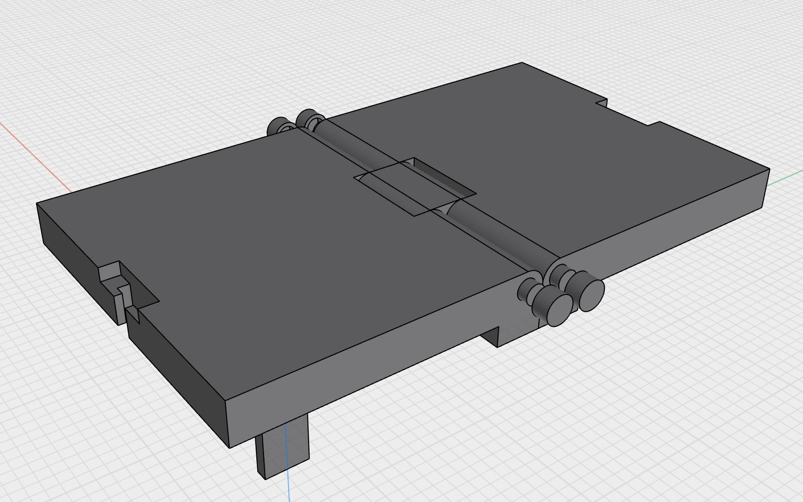
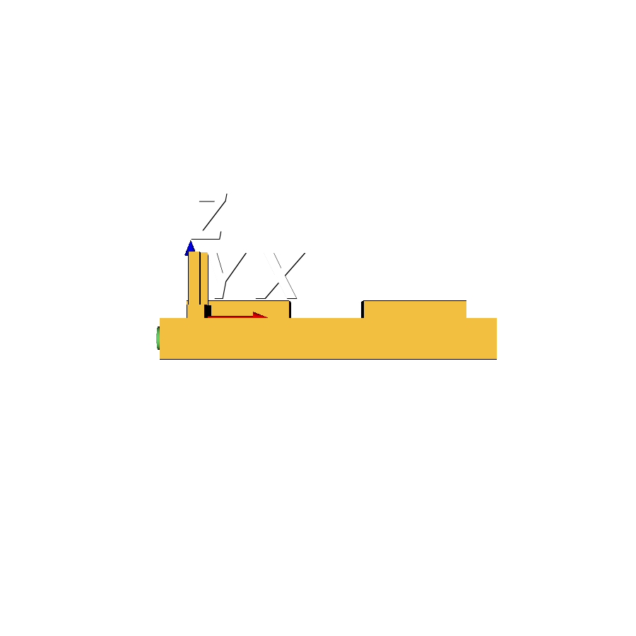
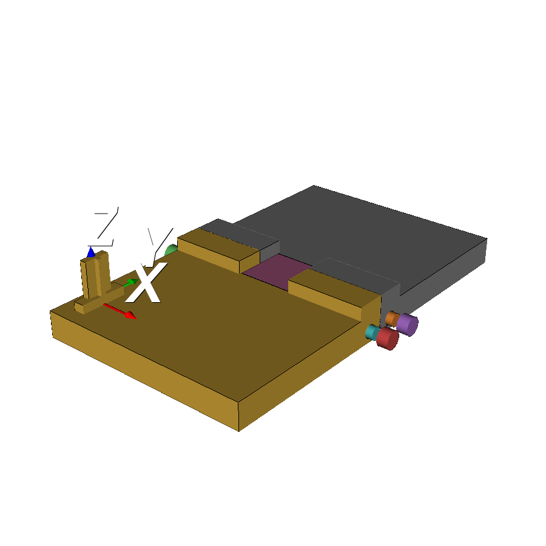
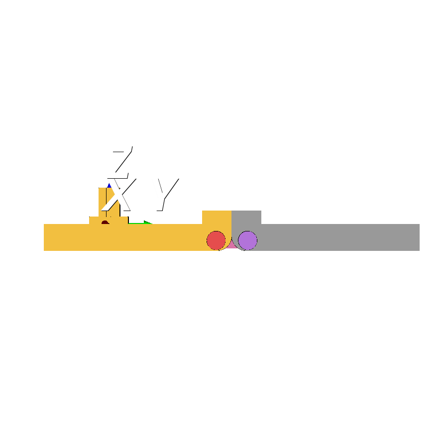
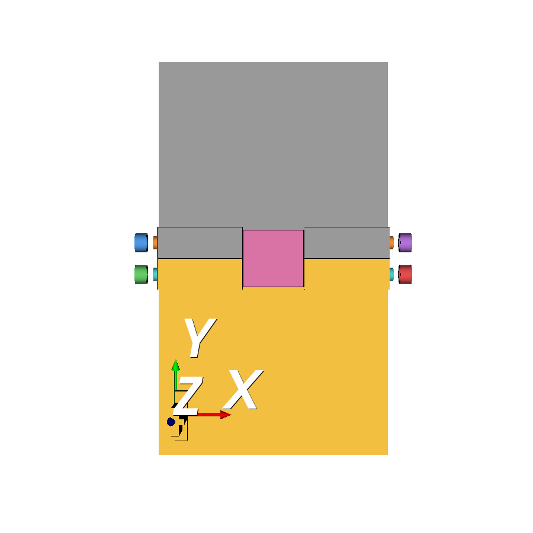
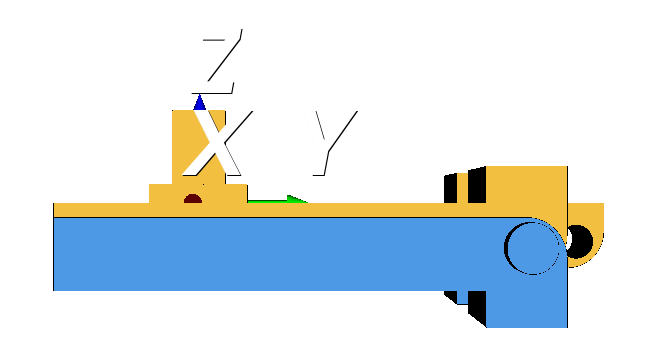
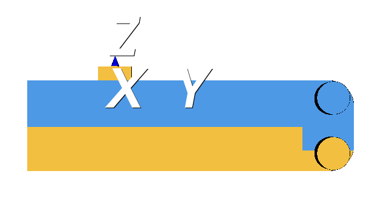
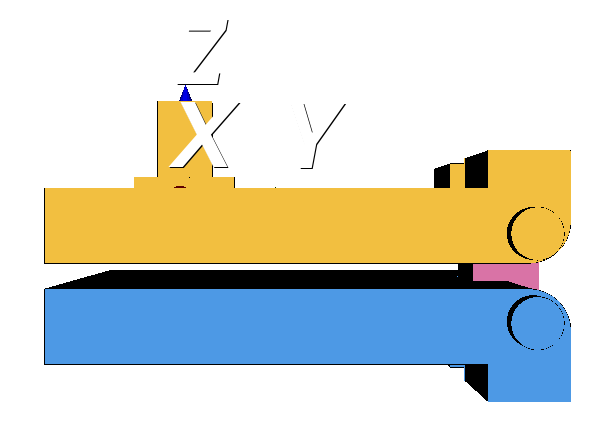

Santa got me a [3D printer](https://us.store.bambulab.com/products/a1-mini) for Christmas this year, and it's turned into an obsession. I mainly wanted a 3D printer so I could make little doodads for my wheelchair. Not many custom accessories exist for wheechairs, and the ones that do are criminally expensive.

I've been learning how to draw 3D models myself using [Shapr3D](https://www.shapr3d.com/), and it's been a bit of a learning curve but has gone well so far for the simpler designs I wanted to try. But as my ideas have gotten more and more complex, I couldn't help but wonder if I could take advantage of AI to assist with the design process.

First I tried to find an API or MCP server for Shapr3D, but there doesn't appear to be one. I did find [blender-mcp](https://projects.blender.org/lab/blender_mcp), which naturally lead to the question, "what is [Blender](https://www.blender.org/)?" I tried it out, but turns out Blender is mostly for mesh editing, not parametric design, so not great for 3D printing mechanical parts.

I turned to Claude, which lead me to [`cadquery`](https://github.com/cadquery/cadquery), which is a python library for parametric design, and also to [OCP CAD Viewer](https://marketplace.visualstudio.com/items?itemName=bernhard-42.ocp-cad-viewer), a VS Code extension for viewing the models. Perhaps I could get some use out of having Claude call `cadquery` to generate new designs or making tweaks to my own.

# Set up

First we initialize the `uv` project with the right dependencies:

```{bash}
uv init --python 3.12 --name cad-test
uv add cadquery ocp-vscode
```

Next the VS Code extention OCP CAD Viewer needs to be installed. This is a viewer for the 3D models that are created with `cadquery`. 

To open the viewer after installing the extension, open the Command Palette (⌘⇧P) then click "OCP CAD Viewer: Open Viewer". It'll open a panel listening on port 3939.

`cadquery` can work with STEP files (I'm sure other formats too, but STEP is good enough for me), so you can drop any existing step file into your repo and display it in the viewer using some code that looks like this:

```{python}
import cadquery as cq
from ocp_vscode import show, set_port

set_port(3939)
show(cq.importers.importStep("path/to/your.step"), names=["my model"])
```

You can then go crazy and ask Claude Code to modify the STEP files you provide or get it to generate its own. 

Problem is...it's not so useful without a lot of help, in my experience so far.

# My use case

I tried at first throwing some big generic questions at Claude, for example to draw something from scratch or to add a whole new feature to a design. It wasn't able to achieve anything useful, because it's got no real concept of physical space. So I then tried to throw some a simpler, more specific question at it to see what it could do with that.

I've been working on a design for a wheelchair tray that slots into my arm rest and folds out in front of me.

{fig-alt="Top view of the wheelchair tray" fig-align="center"}

I designed all of this by hand, but wanted to see if I could get Claude's help to help me figure out the spacing I needed between the pins. Despite my mathematics degree, my brain was short circuiting trying to figure out how far apart they needed to be to ensure the tray would fold flat. I had the pins too far apart, and there was too much space between the two tray halves when folded.

After first testing Claude what it understood about the model, it was clear it wasn't going to be able to help me just by examining the STEP file. I thought that next I should I ask it to produce static `png` views of the model at different rotations so it could better "see" the design. It's not able to "see" what's shown in the OCP CAD Viewer, and I needed to validate that it understood the geometry.

First I just asked it to produce static images for the tray as is:

::: {layout-nrow=2}
{fig-alt="Front view of the wheelchair tray" fig-align="center"}

{fig-alt="Isometric view of the wheelchair tray" fig-align="center"}

{fig-alt="Right view of the wheelchair tray" fig-align="center"}

{fig-alt="Top view of the wheelchair tray" fig-align="center"}
:::

Next I said, "okay that's great, Claude, but now show me the tray folded." Here's what it produced:

{fig-alt="Right view of the folded wheelchair tray, but the tray halves overlap with each other, defying laws of physics" fig-align="center"}

Not great. Clearly Claude is not really understanding that this is a 2-pin hinge, and instead is imagining that it folds across a singular axis that doesn't actually exist. I told it so, and it says, "oops sorry about that, let me try again:"

{fig-alt="Right view of the folded wheelchair tray after Claude's second attempt. Better, but folded in the wrong direction" fig-align="center"}

We're getting closer, but Claude again defies the laws of physics and tries to fold the tray in the wrong direction. I corrected it again, and then it finally produced something realistic:

{fig-alt="Right view of the folded wheelchair tray after Claude's third attempt. Correct folding direction" fig-align="center"}

Finally Claude produced an image that reflects the actual physics of my design. Now for the real test: I asked Claude how much do I need to reduce the spacing between the pins in order to close the gap. It told me that the pins needed to be 16mm apart in order to have 0mm spacing between the tray halves when folded. Currently there was 23mm between the pins, so I needed to move them closer together by 7mm, or each pin 3.5mm closer to the midline. I validated this against the actual measurements of my design in Shapr3D, and it seemed accurate. 

I adjusted my design and clicked "Print". Low and behold...the new printed tray now folded perfectly flat!

# Conclusion

Claude was able to help me solve my very specific design question for this model, but only after a lot of trial and error and coaching. I haven't seen it yet be very useful for anything much more complicated, though I'm sure things will quickly be improving. For one thing, I didn't use any special skills, MCPs or tools, which I'm sure could help improve output and reduce the back-and-forth. Anthropic is also releasing [specific connectors](https://all3dp.com/4/claude-comes-to-cad-anthropics-ai-can-now-help-build-3d-models-in-autodesk-fusion/) with creative and design applications, which promise to expand what's possible. Will the promises be kept? Time will tell.