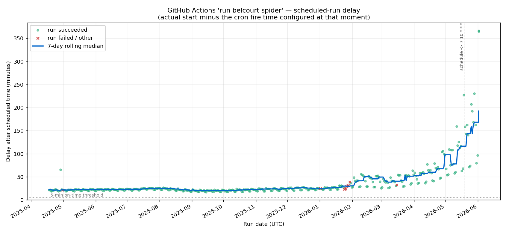

For the past several weeks I've noticed that many of the Github Actions I have running on a schedule have been running hours (!) behind. As an example, here you can see the delays in the scheduled workflow powering my [Belcourt showtimes screen](../webscraping-showtimes/index.qmd):

{fig-alt="Screenshot of GitHub Actions run history for the Belcourt showtimes workflow, showing scheduled run delays getting exponentially worse starting around February 2026."}

In February, the delays start growing practically exponentially. In May, I tried updating the schedule so it runs at the 7th minute instead of top of the hour to try to avoid the back-up that can occur at the 0th minute, but it made no difference.

A quick google shows that [many other people are complaining](https://github.com/orgs/community/discussions/156282) about this too, and there's not really any solution other than taking your cron jobs elsewhere. I saw a few people suggest [cron-job.org](https://cron-job.org/) as a third-party alternative, so I gave it a try. It was super easy to set up and is totally free!

# Step 1: Create a Github Personal Access Token

1. Go to GitHub → Settings → Developer settings → Fine-grained tokens → Generate new token
2. Set:
- Token name
- Expiration (you'll need to regenerate and update cron-job.org when it expires, or the trigger silently stops firing)
- Repository access: Only select repositories (ideally you'd have a separate PAT per repo)
- Permissions → Repository permissions → Actions: set to Read and write
3. Generate it and copy the token

# Step 2: Create the cron job on cron-job.org

1. Sign up / log in at [https://cron-job.org](https://cron-job.org)
2. Click "Create cronjob"
3. Configure the settings. You can see the required settings at [Github's documentation](https://docs.github.com/en/rest/actions/workflows?apiVersion=2026-03-10#create-a-workflow-dispatch-event): 

- URL: `https://api.github.com/repos/{owner}/{repo}/actions/workflows/{workflow_id}/dispatches`
- Schedule: Set timezone and configure the schedule you want. cron-job.org can run up to once a minute
- Expand Advanced settings:
    - Request method: POST
    - Headers (`Key`: `Value`):
        - `Accept`: `application/vnd.github+json`
        - `Authorization`: `Bearer github_pat_...` (your token from Step 1)
        - `X-GitHub-Api-Version`: `2026-03-10`
        - `Content-Type`: `application/json`
    - Request body: `{"ref":"main"}`

4. Save.

# Step 3: Verify

You can then click "Test Run" to test the connection. If you get 200 response code, you're golden. You can also see the job in progress in Github Actions

# Conclusion

Github's [recent issues](https://www.theregister.com/software/2026/02/10/github-seems-to-be-struggling-with-three-nines-availability/4881718) with [downtime](https://mrshu.github.io/github-statuses/) are [well-documented](https://damrnelson.github.io/github-historical-uptime/), though the causes are not entirely clear. It's bad enough that Github has had to release their own (vague) [statements of apology](https://github.blog/news-insights/company-news/an-update-on-github-availability/). It's a sorry state of affairs for a key pillar of the open-source ecosystem.