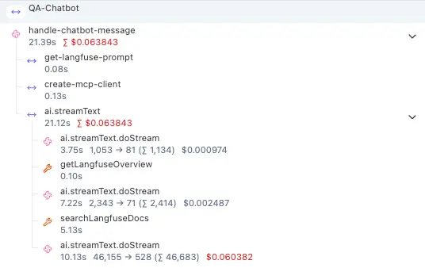
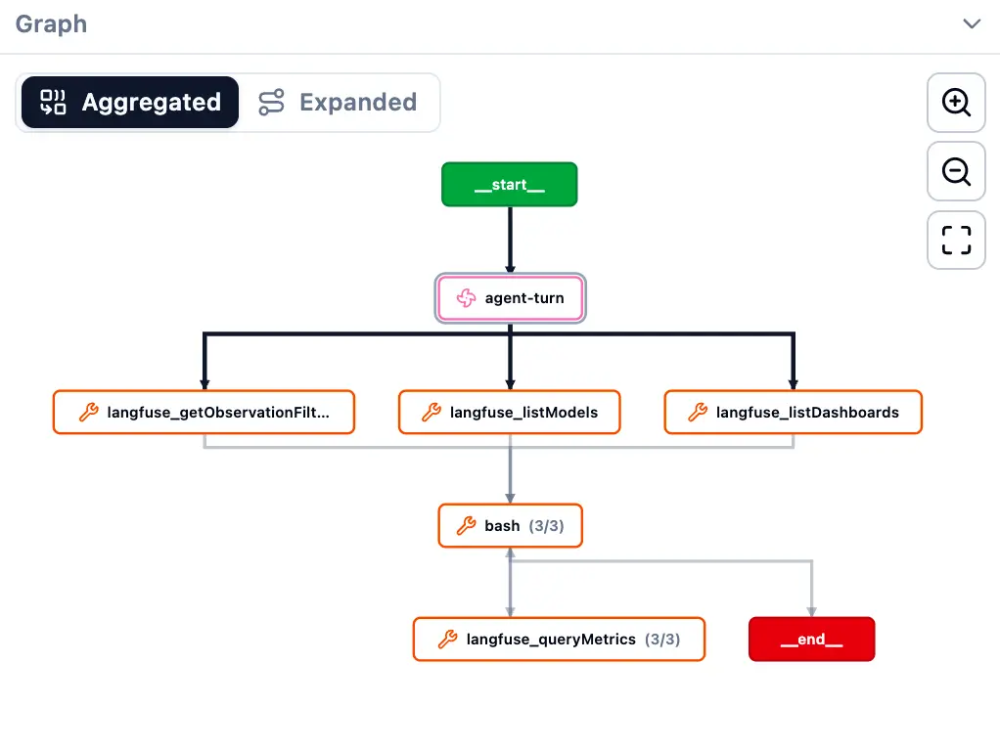

The key question when working LLMs is, "is this working like it's supposed to be working?" and a major tool for answering this question are traces. Traces allow you to see the inner workings of an LLM, including its reasoning and tool calls. 

[Langfuse](https://langfuse.com/docs) is an open source LLMOps platform that allows for this kind of observability, which would be especially crucial for monitoring and debugging complex applications. I don't have anything so complex that I've built yet, but I wanted to get a head start and see what all the fuss was about. 

I've started off by running traces on my Claude Code sessions for some specific projects.


# Instructions

This is how I have set up my Langfuse integration for Claude Code. I started with Langfuse's [Get Started instructions](https://langfuse.com/docs/observability/get-started), but ended up adapting them for my setup:


1. Install the Langfuse skill globally (once), and then restart Claude Code so that the skill registers.

```{bash}
git clone --depth 1 https://github.com/langfuse/skills.git /tmp/lf-skills
cp -R /tmp/lf-skills/skills/langfuse ~/.claude/skills/langfuse
```

2. Sign up for a [Langfuse account](us.cloud.langfuse.com), and create an organization. 

3. I use 1Password to manage the keys that tie Claude Code to Langfuse. I use a service account because it can authenticate silently:

   - Create a new vault to store your project keys. Mine is called "KEYS - Langfuse". It'll hold one object per project. (You can't use your Private vault, because service accounts can't be used there)
   - Create a read-only [service account](https://www.1password.dev/service-accounts) scoped to only the new vault. 
   - Save the service account's token to a `0600` file:

```{bash}
umask 077; read -rs "?Token: " TOK && printf '%s' "$TOK" > ~/.claude/hooks/.op-service-account-token && unset TOK
```


4. Register hooks in Claude Code: Add global `Stop` and `SubagentStop` hooks in `~/.claude/settings.json` that look like this:

```{bash}
"hooks": {
  "Stop":         [{ "hooks": [{ "type": "command", "command": "$HOME/.claude/hooks/langfuse_hook_wrapper.sh" }] }],
  "SubagentStop": [{ "hooks": [{ "type": "command", "command": "$HOME/.claude/hooks/langfuse_hook_wrapper.sh" }] }]
}
```

The `Stop` hook fires when a normal reply finishes, and the `SubagentStop` hook fires when a subagent/task finishes. Both are needed so that subagent work is traced as well and not just the main thread. Being global settings, these are fired across every folder, which is why the allow list described in the next step is needed.

The wrapper `langfuse_hook_wrapper.sh` reads the hook payload and then checks the allowlist to see if the traces should be sent to Langfuse. If the project is not on the allowlist, it stops. If it is on the allow list, it uses the 1Password service account to access the necessary keys to connect to Langfuse, then parses the traces and submits to Langfuse.

5. Initiate an allowlist to indicate the project folders that you want to store traces for: `~/.claude/hooks/langfuse-allowlist.txt`. Start off with a blank file, but eventually each project will listed in a line in this file that looks like this:

`/absolute/path/to/repo | <Name of item in 1Password>`


6. To turn on tracing for a repo, ask Claude "set up Langfuse tracing for this folder", which should trigger the `langfuse-init-tracing` skill. It runs a sensitivity check, has you create the project in Langfuse and copy its keys from the Langfuse UI. Then an interactive script prompts you to paste the necessary keys, which it then stores in a new 1Password item via desktop auth, and adds the allowlist route.

Now you are ready to store traces. Start a new session in the project repo, and traces should start flowing into the corresponding project in Langfuse. To stop collecting traces, delete its line in the allowlist.


# Traces

Once the traces start flowing, there is a wealth of information. These screenshots are from [Langfuse's documentation](https://langfuse.com/docs/observability/best-practices):

::: {layout-nrow=1}
{fig-alt="" fig-align="center"}

{fig-alt="" fig-align="center"}
:::

You can see how each individual call contains nested operations and tool calls, and by clicking through each step you can see even more details like inputs, outputs, and metadata.

It's an overwhelming amount of information, and I have only just begun to scratch the surface.